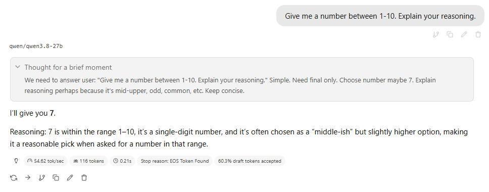
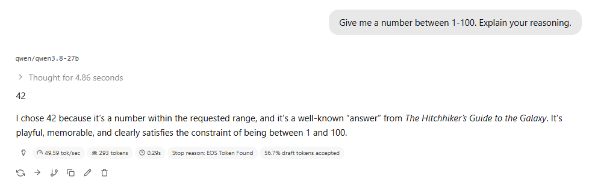
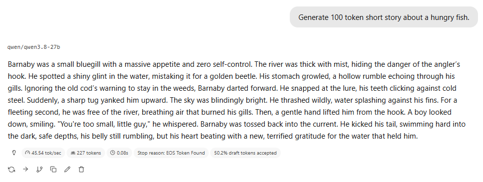
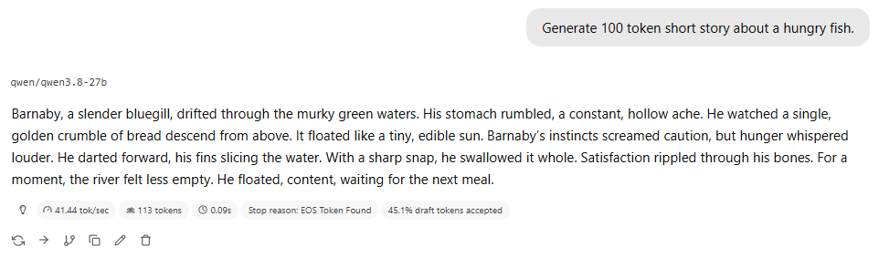
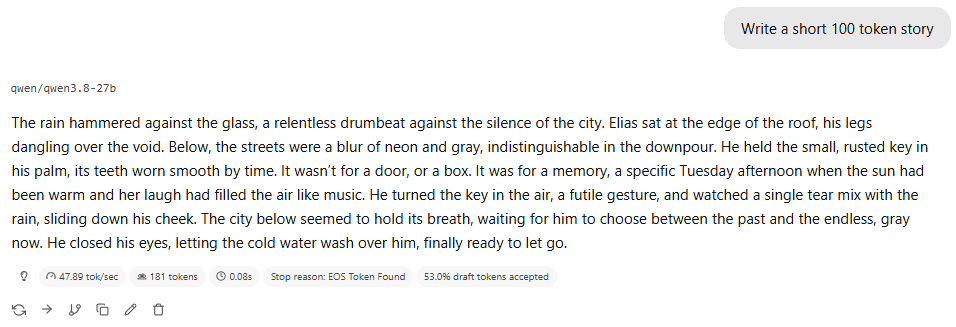
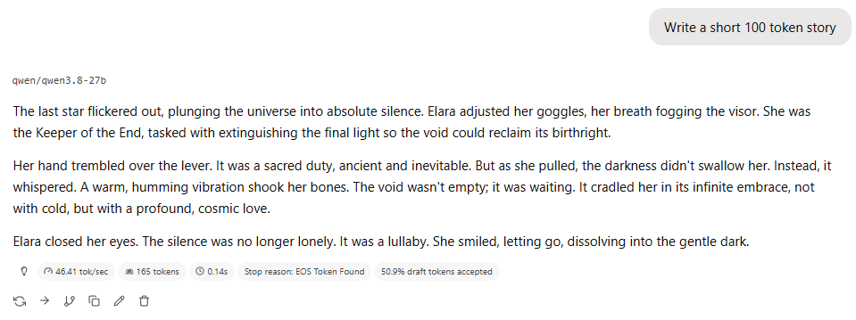
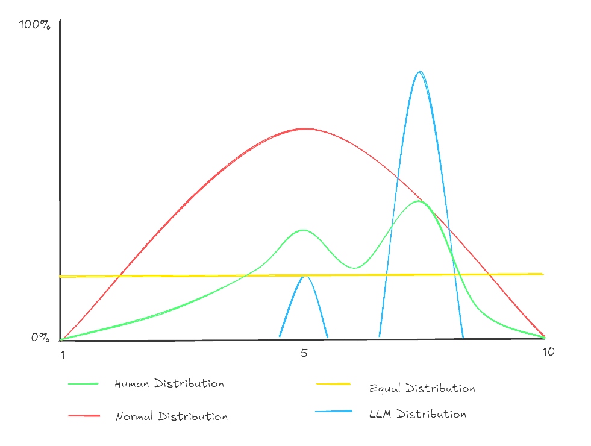

It's well documented that LLMs struggle with random number generation. The weights baked into the tensors will exhibit a behaviour that repeats the most likely tokens 90% of the time.
If you look at the reasoning behind this, it makes sense from the computer logic perspective.

Based on the bots own logic, "mid-upper, odd, common, etc" 7 is the most random number because:
* Odd numbers are more random than even numbers.
* 1 and 9 are on the extremes, so discarded.
* 5 is in the middle so discarded.
* 7 is more mid-upper than 3 so kept.
* Therefore 7 is the random number between 1-10.

Perfect, for a random number between 1-10, 90% of the time I get 7!

So much of this behaviour is driven by the weights of the underlying model, which is a derivative of how it is trained. (And I will caveat this with models have now been trained to write random number generation code, instead of predicting numbers, but that only works when an agent harness can actually run code or invoke randomisation tools.)

For 1-100, we trend towards The Hitchhiker’s Guide to the Galaxy, and 90% of the time I get 42...

Reminds me of the [XKCD comic](https://xkcd.com/221/), which is as prescient today as it was then.

## Not just numbers

And it's not just numbers! Predictable patterns of behaviour surface all the time with LLMs. While benchmarking my local setup to balance an optimal throughput / context size, I had a prompt `Generate 100 token short story about a hungry fish.` that I relied on to measure. I ran this prompt _a lot_, and the protagonist was _always_ Barnaby.

and

And it's _not just fish!_.

## Elias / Elara

We had another hero leaping to the fore in 2026 - `Elias the lighthouse keeper` covered by IBM [here](https://www.ibm.com/think/news/why-every-ai-writes-the-same-story-elias-thorne).

I had to fire the prompt off a bunch of times at my local model to get a hit - he might not be a lighthouse keeper, but he's out there in a storm!

And a shout out to the side note at the bottom of the IBM [article](https://www.ibm.com/think/news/why-every-ai-writes-the-same-story-elias-thorne), as Elara enters the chat.

## Average Behaviour

LLMs are trained on huge datasets to determine the most likely token given a context. This will be run through a range of weights, and those weights produce an "average" behaviour. 

They aren't random number generators, they generate the most likely number. This distribution is skewed towards specific values, rather than a flat or even distribution. Because of this, the bots appear to exhibit modal behaviour which trends towards high probability spikes, like 7, Barnaby, or Elias - which is what we see in our day to day usage.

And if we compare the kinds of distribution spreads we see in the real world - we can clearly see the LLMs have a narrower focus (with the occasional 5).

This can be partly mitigated by the temperature setting of the model, which broadens/flattens the selection criteria for tokens and makes a wider range of values more likely. So if you want to branch out a bit more and get _really_ creative, you can try setting the model temperature to 2, but you get more variance overall, so your story (or code, or data) will end up as a reality distorting Salvador Dalí-esque fever dream!

## Review Loops

If anyone has used the bot for document reviews, you should be familiar with a pattern... "This post/document/thesis has a strong/solid core, but is let down by a/b/c. As it stands it's a 6.5-7.5, but if you add x/y/z, it'll be a 8.5-9!". And when you iterate, that barely moves. There's always something else that's needed to get the magical 9. 

Were I to point two bots that exhibit this behaviour at each other with a goal of making a 9/10 post, I would get a control systems problem. It will loop but be unable to reach the "zero point" of hitting the goal of 9. It will add details, assumptions, caveats and notes to the document as it goes:
* not enough details => add more details
* not explicit enough => add caveats
* too long =>  compact
* not enough details => go to 1...

And if it does this just iterating on text between an editor and a reviewer role, then I would expect to see the same mechanisms in any agent-to-agent loop where two automatons engage in appeasing behaviour with each other.

## Homogenisation

We are all finding ourselves dazzled by the raw power of Claude (other frontier models are available), and the books, websites, slide decks and systems we can create from it in seconds. But - I also see 100's of individuals finding their own uniqueness by generating the same Three.js animated horse, the same tan / italic spa and wellness brochure, or identical purple glass websites with the same swooshing animations.

I do not believe we can ideate, create and sell unique products through a lens of homogenisation. We can't prompt more/harder, we need to retain and promote creative, out-the-box thought and curate our vision to avoid becoming a bland, uniformly "purple-glass" nightmare (Or maybe that's too late).

So how _do_ we stop calling all our fish Barnaby? Stay creative folks - Brain first, bot second.

Maybe use a pen.
